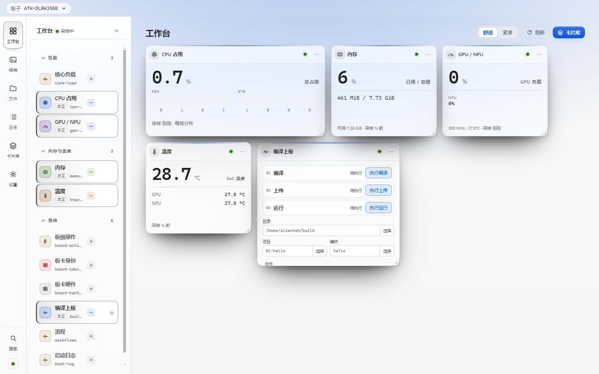

# DevBoard Cockpit

[中文](README.md)

A Windows desktop workbench for embedded Linux boards. A standard set of board metrics exposes runtime state, composable cards build live instrumentation and controls, and workflow packs orchestrate build, deployment and verification tasks. The same capabilities are available to external agents through MCP.



## Core capabilities

- **Standard runtime metrics**: CPU, cores, memory, GPU/NPU, temperature and frequency use consistent names and states for healthy, stale, unavailable, error and awaiting-sample conditions.
- **Composable workbench**: live data, device controls and task entry points are organised as cards with grouping, pinning, drag-and-drop layout, resizing and hot reload.
- **End-to-end development tasks**: terminal access, file transfer, compilation, upload, execution, board health checks, network tests and storage benchmarks.
- **Multiple transports**: ADB, serial and SSH, with automatic selection of a working link for the current board.
- **Board onboarding**: automatic serial-port and model detection generates a user board pack and connection profile. User-added boards can be removed from the board menu.
- **Complete boot logs**: persistent kernel and user-space boot records are read over serial, stored on the host and displayed locally, avoiding the limited ADB kernel ring buffer.
- **Permissions and verified state**: device actions and workflows are authorised separately, destructive actions are disabled by default, and control actions read the resulting board state instead of reporting an optimistic value.
- **MCP integration**: external agents can read runtime metrics, invoke authorised actions and manage cards and workflows through the local MCP service.
- **Hardware-free development**: the bundled synthetic board supports the complete working flow without physical hardware and is identified as synthetic data throughout the application.

## Design and reliability

- **Contract-driven**: runtime metrics, board packs, card manifests, workflows and MCP tools are defined in `docs/spec/`; the implementation maps to those contracts directly.
- **Board-pack isolation**: cards and workflows remain independent of model-specific access details, which are declared by the board pack.
- **Sandboxed cards**: cards run in isolated iframes with a whitelisted host API and a network-blocking Content Security Policy.
- **Hot-reloadable extensions**: a card is an HTML, JavaScript and CSS directory; file changes apply without restarting the application.
- **Auditable workflows**: multi-step tasks provide staged status, timeouts, cancellation and result verification, with cross-machine roles bound to connection profiles.

## Installation

Windows x64 installers are available on the [Releases](https://github.com/milkytheway/DevBoardCockpit/releases) page. The installer is not code-signed, so Windows SmartScreen may request confirmation. Each release also provides `SHA256SUMS.txt` for integrity verification.

Connection settings are stored in `%LOCALAPPDATA%\DevBoardCockpit\` and are not removed automatically during upgrade or uninstallation.

## Connecting a board

| Transport | Use | Main parameters |
|---|---|---|
| ADB | Debugging and file transfer | Board serial |
| Serial | Debug console and boot logs | Port and baud rate |
| SSH | Remote login and file transfer | Host, user and credential |

The bundled ATK-DLRK3588 board kit defaults to 1500000 baud. For an unfamiliar board, the onboarding wizard probes the serial port and board model, then generates a board-specific profile from the generic board pack. See the [board setup tutorial](docs/tutorial/01-build-a-board-pack.en.md).

## Extension model

- **Cards**: HTML, JavaScript and CSS with declared tag, action and workflow permissions. See the [card design rules](docs/tutorial/03-card-design-rules.md).
- **Board packs**: YAML definitions for board identity, tag sources, device actions and detection rules.
- **Workflow packs**: YAML definitions for multi-step tasks, cross-machine roles, timeouts, cancellation and result verification.
- **MCP**: a local MCP service starts with the application; its port and bearer token are written to `mcp.json` in the user data directory.

## Local development

Requirements: Windows and Node.js 20.19 or later.

```bash
npm install
npm run dev
```

Common checks:

```bash
npm run lint
npm run typecheck
npm test
npm run test:cards
```

## Documentation

- [Contract overview](docs/spec/00-overview.md)
- [Tag contract](docs/spec/01-tag-contract.md)
- [Board pack format](docs/spec/02-board-pack.md)
- [Card manifest](docs/spec/03-card-manifest.md)
- [MCP tools](docs/spec/04-mcp-tools.md)
- [Workflow pack format](docs/spec/05-workflow-pack.md)
- [Measured device facts](docs/02-device-facts.md)
- [Board setup tutorial](docs/tutorial/01-build-a-board-pack.en.md)
- [Card design rules](docs/tutorial/03-card-design-rules.md)

## License

[MIT](LICENSE)
