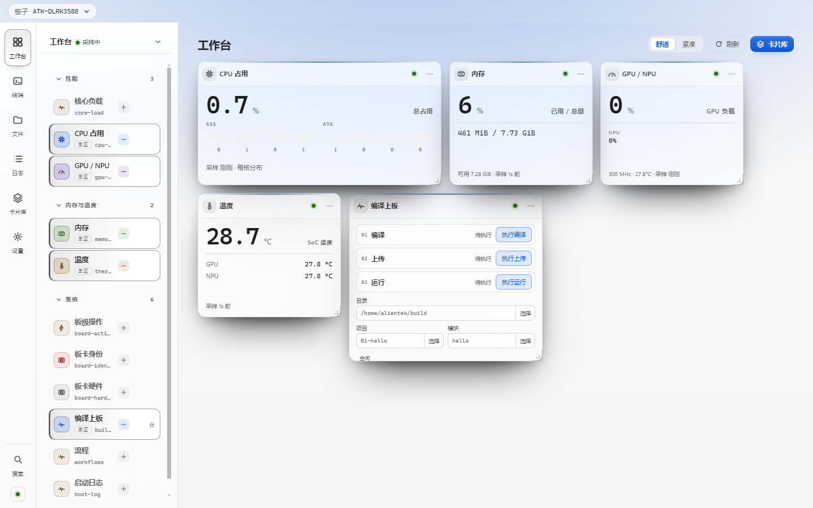

# DevBoard Cockpit

[English](README.en.md)

面向嵌入式 Linux 开发板的 Windows 桌面工作台。通过 ADB、SSH、串口连接板卡，以标准板卡指标读取运行状态，通过可组合卡片封装一套操作、构建实时监控与操作面板，通过流程包编排编译、部署和验证任务；同一套能力也可通过 MCP 提供给外部 agent，与 AI 协作完成嵌入式开发。



## 核心能力

- **标准运行指标**：CPU、核心、内存、GPU/NPU、温度、频率等指标采用统一命名与状态模型，区分正常、滞后、不可用、读取失败和等待采样。
- **可组合工作台**：实时数据、设备控制和任务入口以卡片组织，支持分组、置顶、拖动、调整尺寸和热加载。
- **端到端开发流程**：覆盖终端、文件传输、编译、上传、运行、板卡体检、网络与存储测试等常见嵌入式开发任务。
- **多通道连接**：支持 ADB、串口和 SSH，并可根据板卡、传输方式和可用能力自动选择连接通道。
- **开发板接入向导**：自动探测串口和板卡型号，生成用户板型包与连接配置；用户添加的开发板可从板卡菜单删除。
- **完整启动日志**：通过串口读取持久化内核与用户态启动记录，在主机侧保存并显示，不依赖容量有限的 ADB 内核缓冲区。
- **权限与状态回读**：设备操作和流程分别授权，危险操作默认关闭；控制动作执行后读取板卡真实状态，不只展示应用侧的预期结果。
- **MCP 扩展**：外部 agent 可通过本地 MCP 服务读取运行指标、执行授权动作，并管理卡片与流程。
- **无硬件开发**：内置合成开发板，没有实体设备时仍可使用完整工作流，并在所有数据位置明确标记合成来源。

## 设计与可靠性

- **契约驱动**：运行指标、板型包、卡片清单、流程包和 MCP 工具由 `docs/spec/` 统一定义，实现与契约逐项对应。
- **板型包隔离硬件差异**：同一套卡片和流程可适配不同板型，硬件访问方式由板型包声明。
- **卡片沙箱**：卡片运行在隔离 iframe 中，只能访问宿主的白名单 API，并通过 CSP 阻断网络访问。
- **热更新扩展**：卡片是普通 HTML、JavaScript 和样式目录；修改文件后自动重新加载，无需重启应用。
- **流程可审计**：多步骤任务具备阶段状态、超时、取消和结果校验，跨机器任务通过角色绑定连接。

## 安装

Windows x64 安装包发布在 [Releases](https://github.com/milkytheway/DevBoardCockpit/releases)。安装包未进行代码签名，Windows SmartScreen 可能要求确认来源；发布页同时提供 `SHA256SUMS.txt` 用于完整性校验。

连接配置保存在 `%LOCALAPPDATA%\DevBoardCockpit\`，升级或卸载应用不会自动删除这些用户数据。

## 接入开发板

| 传输方式 | 适用场景 | 主要参数 |
|---|---|---|
| ADB | 调试、文件传输 | 板卡序列号 |
| 串口 | 调试控制台、启动日志 | 端口、波特率 |
| SSH | 远程登录、文件传输 | 主机、用户、凭据 |

内置的 ATK-DLRK3588 板卡套件默认使用 1500000 波特率。接入未知板卡时，开发板向导会探测串口和板卡型号，并依据通用板型包生成对应配置。具体流程见[开发板接入教程](docs/tutorial/01-build-a-board-pack.zh-Hans.md)。

## 扩展方式

- **卡片**：使用 HTML、JavaScript 和 CSS 构建，声明所需位号、动作和流程权限。规范见[卡片设计规则](docs/tutorial/03-card-design-rules.md)。
- **板型包**：使用 YAML 声明板卡身份、位号数据源、设备动作和自动识别规则。
- **流程包**：使用 YAML 描述多步骤任务、跨机器角色、超时、取消和结果校验。
- **MCP**：应用启动后在本地提供 MCP 服务，端口和访问令牌写入用户数据目录中的 `mcp.json`。

## 本地运行

依赖 Windows 与 Node.js 20.19 或更高版本。

```bash
npm install
npm run dev
```

常用校验：

```bash
npm run lint
npm run typecheck
npm test
npm run test:cards
```

## 文档

- [契约总览](docs/spec/00-overview.md)
- [位号契约](docs/spec/01-tag-contract.md)
- [板型包格式](docs/spec/02-board-pack.md)
- [卡片清单](docs/spec/03-card-manifest.md)
- [MCP 工具集](docs/spec/04-mcp-tools.md)
- [流程包格式](docs/spec/05-workflow-pack.md)
- [设备实测事实](docs/02-device-facts.md)
- [开发板接入教程](docs/tutorial/01-build-a-board-pack.zh-Hans.md)
- [卡片设计规则](docs/tutorial/03-card-design-rules.md)

## 许可

[MIT](LICENSE)
